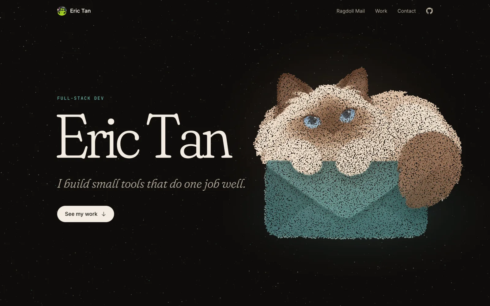
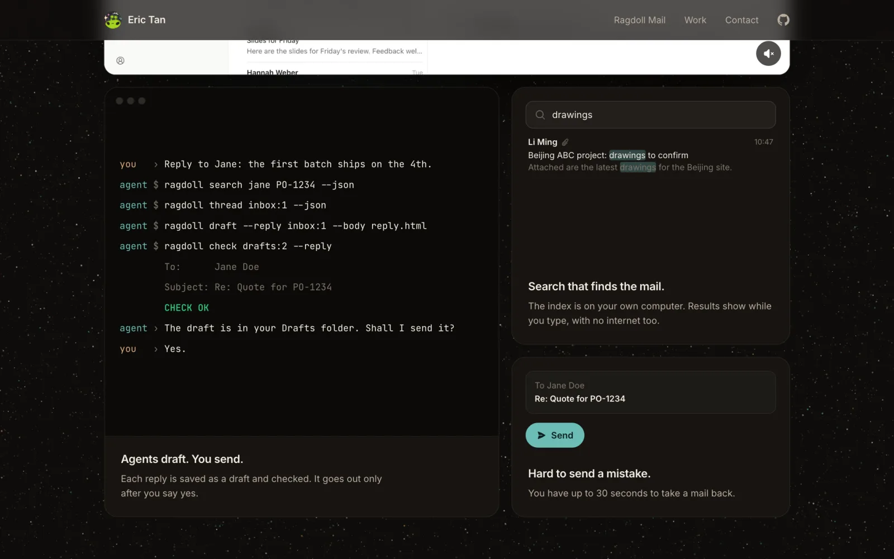
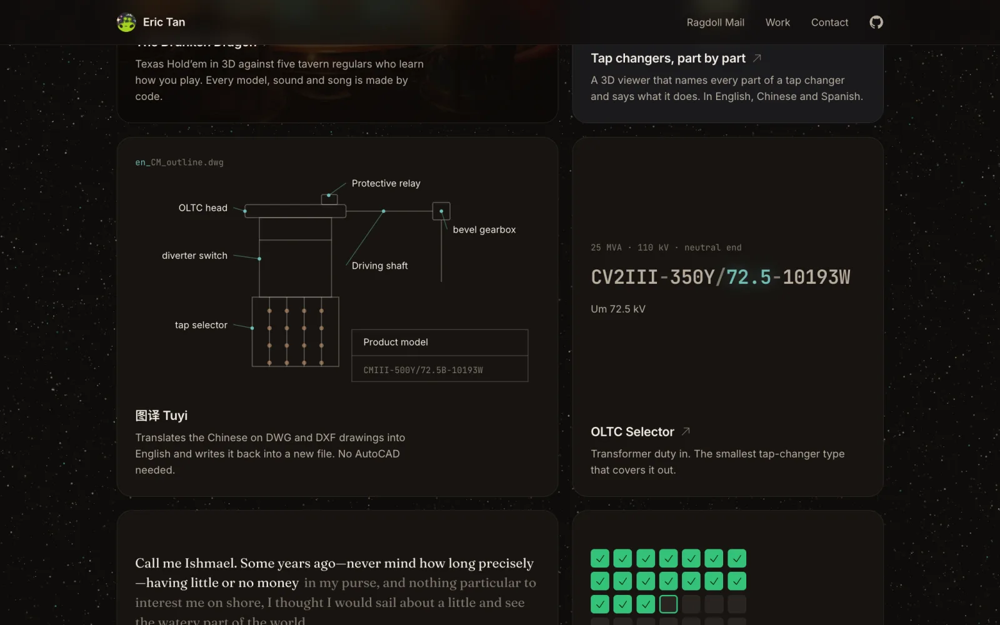

<p align="center">
  <a href="https://erict16.github.io/"></a>
</p>

<h1 align="center">Eric Tan</h1>

<p align="center"><b>My personal site. Small tools that do one job well, with Ragdoll Mail up front.</b></p>

<p align="center">
  <a href="https://github.com/erict16/erict16.github.io/actions/workflows/pages.yml"></a>
  
  
  <a href="LICENSE"></a>
</p>

<p align="center">
  <a href="https://erict16.github.io/"><b>Open the site</b></a> ·
  <a href="https://erict16.github.io/ragdoll-mail/"><b>Ragdoll Mail</b></a> ·
  <a href="https://github.com/erict16"><b>GitHub</b></a>
</p>

## What is on the page

| Part             | What you see                                                                                                                                                       |
| ---------------- | ------------------------------------------------------------------------------------------------------------------------------------------------------------------ |
| **Hero**         | About 33,000 points fly in and build the Ragdoll cat. Move the pointer and they move out of the way. Scroll, and they drift apart as dust.                         |
| **Ragdoll Mail** | The demo film tips up as it comes into view. Below it, three cards you can use: an AI agent replying from the terminal, search as you type, and Send with an Undo. |
| **More work**    | The Drunken Dragon, the tap-changer 3D viewer, 图译 Tuyi (a drawing that translates its own labels), OLTC Selector, TypeBooks and 500 Words.                       |
| **Say hello**    | The points gather into a turning sphere beside the mail address.                                                                                                   |

<table>
<tr>
<td></td>
<td></td>
</tr>
</table>

## How the cat works

1. `public/static/home/cat.png` is the cat and envelope from the Ragdoll Mail icon, cut free of the background.
2. Each solid pixel becomes one point, with its own colour.
3. Every point has three places to be: in the cat, in the dust, and on the sphere. A small shader moves it between them as you scroll. It is one draw call with no 3D library.
4. With no WebGL, the page shows the plain icon. With "reduce motion" turned on, nothing moves.

## Run it

You need Node.js 20 and pnpm.

```bash
pnpm install
pnpm dev
```

Then open http://localhost:3000. To check the real build, run `pnpm build` and open `out/index.html` through any static server.

## Change something

| To change                      | Edit                                                                             |
| ------------------------------ | -------------------------------------------------------------------------------- |
| Project names, texts, links    | `data/projects.ts`                                                               |
| The page itself                | `app/page.tsx`                                                                   |
| Colours, type, layout          | `app/globals.css` (the colours are at the top)                                   |
| The points                     | `ui/Particles.tsx`                                                               |
| A live demo in a card          | `ui/Terminal.tsx`, `SearchDemo.tsx`, `UndoSend.tsx`, `TuyiDrawing.tsx`, and more |
| Scroll reveal, tilt and glow   | `ui/Effects.tsx`                                                                 |
| Title, description, share card | `app/layout.tsx` and `public/static/images/og.png`                               |

Before you push, run `pnpm lint` and `pnpm lint:format`.

## Publish

GitHub Pages cannot run a Node server, so the site is built as static files (`output: 'export'`). Push to `main`, and [the workflow](.github/workflows/pages.yml) builds `out/` and publishes it to [erict16.github.io](https://erict16.github.io/).

## License

[MIT](LICENSE)
